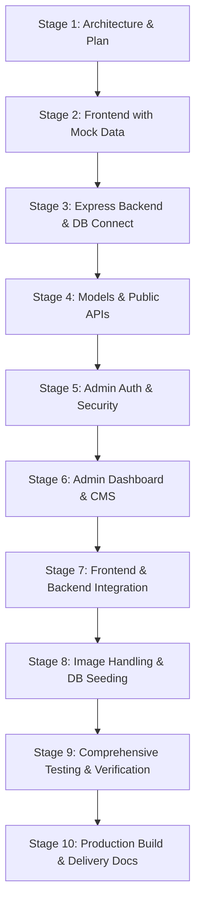

# Getva Hotel — Full MERN Stack Architecture & Implementation Plan

> **Location:** Debre Birhan, Amhara Region, Ethiopia  
> **Aesthetic DNA:** Editorial Luxury, High-End Hospitality & Curated Club Aesthetic  
> **Status:** Proposed Client Prototype (Clearly identified demonstration with realistic placeholder content)

---

## 1. System Architecture Overview

The application follows a clean decoupled MERN stack architecture with modular client and server trees:

```
Getiva Hotel/
├── client/                     # Frontend SPA (React 19 + Vite 6 + Tailwind CSS v4 / Vanilla CSS tokens)
│   ├── public/                 # Static assets, favicon, robots.txt, sitemap.xml
│   ├── src/
│   │   ├── assets/             # Curated hotel imagery & logos
│   │   ├── components/         # Reusable UI elements (Navbar, Footer, Button, RoomCard, Dialog, Toast, etc.)
│   │   ├── layouts/            # PublicLayout, AdminLayout
│   │   ├── pages/              # Home, Rooms, RoomDetails, Restaurant, Events, Gallery, About, Contact, Admin
│   │   ├── hooks/              # useAuth, useInquiries, useScrollPosition, useDialog
│   │   ├── services/           # api.js (Axios/Fetch client with unified interceptors & error handlers)
│   │   ├── styles/             # index.css (Luxury design tokens, Playfair Display & Outfit fonts)
│   │   └── utils/              # formatters, validators
│   ├── .env.example
│   ├── index.html
│   ├── package.json
│   └── vite.config.js
│
├── server/                     # Backend REST API (Node.js + Express + Mongoose)
│   ├── src/
│   │   ├── config/             # Database connection, security settings, environment variables
│   │   ├── controllers/        # room, inquiry, gallery, content, auth, admin controllers
│   │   ├── middleware/         # auth (JWT/Cookie), role check, rate limiter, validation (Zod), errorHandler
│   │   ├── models/             # Room, BookingInquiry, ContactInquiry, GalleryImage, SiteContent, AdminUser
│   │   ├── routes/             # rooms, inquiries, gallery, content, auth, admin routes
│   │   ├── seed/               # Realistic seed script for demonstration rooms, suites, dining, and gallery
│   │   ├── utils/              # Token generation, logger, slugify, safe responses
│   │   └── server.js           # Express app initialization, Helmet, CORS, and graceful shutdown
│   ├── .env.example
│   ├── package.json
│   └── vitest.config.js
│
├── UI_STYLE_PROMPT.md          # Official UI Style & Tokens Blueprint
├── README.md                   # Complete deployment, bootstrapping & usage documentation
└── .gitignore
```

---

## 2. Design System Alignment (`UI_STYLE_PROMPT.md`)

The user interface strictly implements the approved design tokens:

| Element | Specification / Token | Usage |
| :--- | :--- | :--- |
| **Canvas Surface** | `#f9f9f9` (Porcelain Soft Linen) | Primary page background |
| **Card / Surface** | `#ffffff` (Pure White) + `1px #c4c7c7/10` border | Room cards, booking modals, admin panels |
| **High Contrast Ink** | `#1a1c1c` (Deep Obsidian Ink) | Headings, body text |
| **Muted Ink** | `rgba(0,0,0,0.55)` - `rgba(0,0,0,0.70)` | Subtitles, meta info, captions |
| **Primary Accent** | `#775a19` (Antique Brass / Warm Gold) | Badges, active tabs, highlights, links |
| **Accent Container** | `#fed488` / `#fef3db` | Subtle chip backgrounds |
| **Primary Button** | `#000000` shifting to `#775a19` on hover | High-impact CTAs, form submissions |
| **Typography - Display**| `Playfair Display`, serif | Hero titles, section headings, room titles |
| **Typography - UI** | `Outfit`, sans-serif | Navigation, body paragraphs, forms, tables |
| **Eyebrows / Badges** | `text-[9px]` or `text-[10px]`, `tracking-[0.2em]`, uppercase | Category labels, super-headings |
| **Elevation & Motion** | `.ambient-shadow`, `all 0.4s cubic-bezier(0.16, 1, 0.3, 1)` | Butter-smooth card hover & modal fades |

---

## 3. Database Schema Models (Mongoose)

### 3.1. `Room`
- `name`: String (Required, trimmed)
- `slug`: String (Unique, indexed, slugified from name)
- `shortDescription`: String (Brief highlight)
- `description`: String (Detailed description)
- `images`: Array of `{ url: String, alt: String, isPrimary: Boolean }`
- `capacity`: `{ adults: Number, children: Number, maxGuests: Number }`
- `bedType`: String (e.g., "King Bed", "Twin Luxury")
- `roomSize`: String (e.g., "45 m² / 484 sq ft")
- `amenities`: `[String]` (e.g., "Highlands View", "High-Speed Wi-Fi", "Fireplace", "En-suite Bath", "24/7 Room Service")
- `pricePerNight`: `{ amount: Number, currency: { type: String, default: "ETB" }, isPriceApproved: Boolean }`
- `published`: Boolean (Default: true)
- `sortOrder`: Number (Default: 0)
- `featured`: Boolean (Default: false)
- Timestamps: `createdAt`, `updatedAt`

### 3.2. `BookingInquiry`
- `guestName`: String (Required)
- `email`: String (Optional if phone provided)
- `phone`: String (Required if email missing)
- `room`: ObjectId ref `Room` (Optional)
- `checkIn`: Date (Optional)
- `checkOut`: Date (Optional)
- `guests`: `{ adults: Number, children: Number }`
- `message`: String
- `status`: String (`pending`, `reviewed`, `contacted`, `archived`)
- `internalNotes`: String
- Timestamps: `createdAt`, `updatedAt`

### 3.3. `ContactInquiry`
- `name`: String (Required)
- `email`: String
- `phone`: String
- `subject`: String
- `message`: String (Required)
- `status`: String (`new`, `in_progress`, `responded`, `closed`)
- Timestamps: `createdAt`, `updatedAt`

### 3.4. `GalleryImage`
- `url`: String (Required)
- `alt`: String
- `caption`: String
- `category`: String (`rooms`, `dining`, `events`, `exterior`, `wellness`)
- `sortOrder`: Number (Default: 0)
- `published`: Boolean (Default: true)
- Timestamps: `createdAt`, `updatedAt`

### 3.5. `SiteContent`
- `section`: String (Unique key: `homepage`, `about`, `restaurant`, `events`, `contact`, `branding`)
- `data`: Object (Dynamic JSON structure for editable headlines, copy, hours, phone, address)
- `updatedBy`: ObjectId ref `AdminUser`
- Timestamps: `createdAt`, `updatedAt`

### 3.6. `AdminUser`
- `email`: String (Unique, lowercase, validated)
- `passwordHash`: String (bcrypt hashed, min 10 rounds)
- `name`: String
- `role`: String (`superadmin`, `manager`)
- Timestamps: `createdAt`, `updatedAt`

---

## 4. API Endpoints Specification

### 4.1. Public Endpoints
- `GET /api/health` — API health check and DB status
- `GET /api/rooms` — Query published rooms (supports search, sort, filter by capacity)
- `GET /api/rooms/:slug` — Single room details by slug
- `GET /api/gallery` — Published gallery items (category filter)
- `GET /api/content/:section` — Public page content blocks
- `POST /api/inquiries/booking` — Submit booking inquiry with Zod validation and rate limiting
- `POST /api/inquiries/contact` — Submit general contact inquiry with rate limiting

### 4.2. Authentication Endpoints
- `POST /api/auth/login` — Authenticate admin, issue secure JWT (cookie & token response)
- `POST /api/auth/logout` — Clear session cookie
- `GET /api/auth/me` — Verify token and return current admin profile

### 4.3. Protected Administrator Endpoints
- `GET /api/admin/dashboard` — Statistics (counts of rooms, gallery, pending inquiries)
- `GET /api/admin/rooms`, `POST /api/admin/rooms`, `PATCH /api/admin/rooms/:id`, `DELETE /api/admin/rooms/:id`
- `GET /api/admin/gallery`, `POST /api/admin/gallery`, `PATCH /api/admin/gallery/:id`, `DELETE /api/admin/gallery/:id`
- `GET /api/admin/inquiries/booking`, `PATCH /api/admin/inquiries/booking/:id`
- `GET /api/admin/inquiries/contact`, `PATCH /api/admin/inquiries/contact/:id`
- `GET /api/admin/content/:section`, `PUT /api/admin/content/:section`

---

## 5. Security Architecture

1. **Helmet & Security Headers:** Content-Security-Policy, HSTS, X-Content-Type-Options, Frameguard.
2. **Rate Limiting:** Specific strict rate limits on `/api/auth/login` (5 attempts per 15 min) and inquiry endpoints (10 submissions per hour).
3. **Password Security:** Bcrypt hashing with salt rounds. No plaintext storage.
4. **CORS:** Configured explicitly to client origin (`http://localhost:5173` in development).
5. **No Stack Traces:** Centralized error-handling middleware returns sanitized user-friendly errors in production.
6. **No Fake Bookings Disclaimer:** The UI and API explicitly treat requests as inquiries, with clear disclaimers that confirmation is handled by hotel reception.

---

## 6. Execution Roadmap (10 Stages)



- **Stage 1 (Current):** Inspection, architecture plan, and setup.
- **Stage 2:** Complete responsive frontend in `client/` matching `UI_STYLE_PROMPT.md` tokens.
- **Stage 3:** Express server setup, MongoDB connection with auto in-memory fallback for local execution, middleware.
- **Stage 4:** Mongoose models, validation schemas, and public REST endpoints.
- **Stage 5:** Admin authentication, JWT signing, password hashing, and authorization guards.
- **Stage 6:** Admin dashboard UI (rooms, gallery, inquiries, content management).
- **Stage 7:** Wire React frontend with backend API services.
- **Stage 8:** Seed realistic Debre Birhan demo rooms, dining menus, and gallery items.
- **Stage 9:** Vitest/Supertest test suites, browser testing, responsiveness check.
- **Stage 10:** Production build validation, README.md, and demonstration report.
